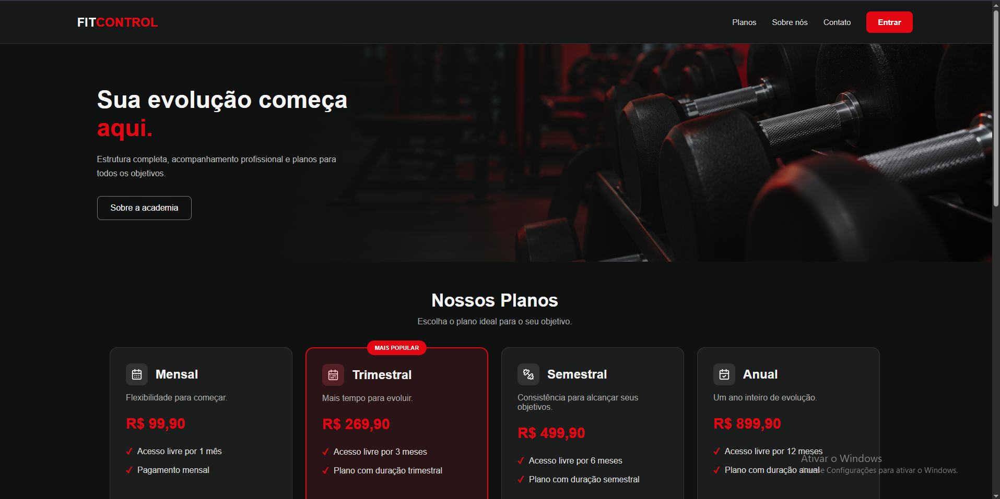
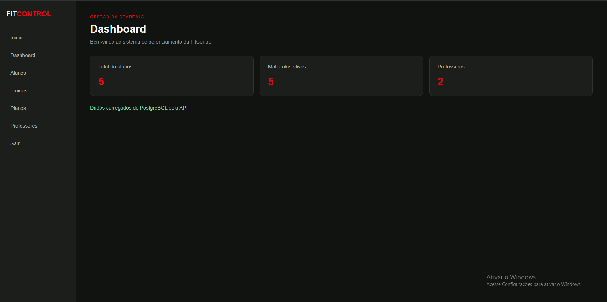
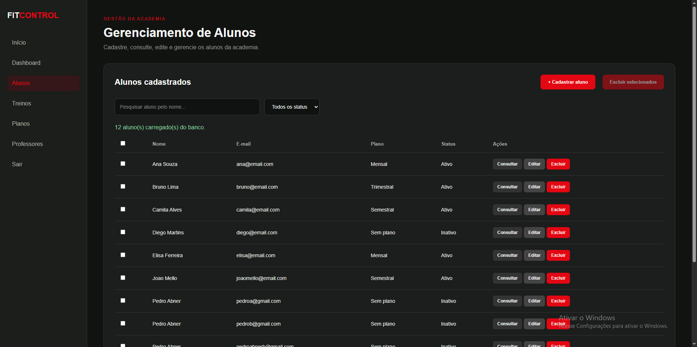
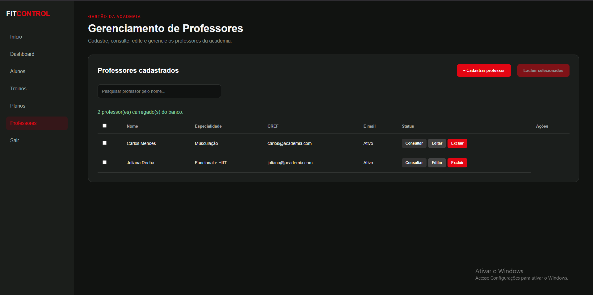
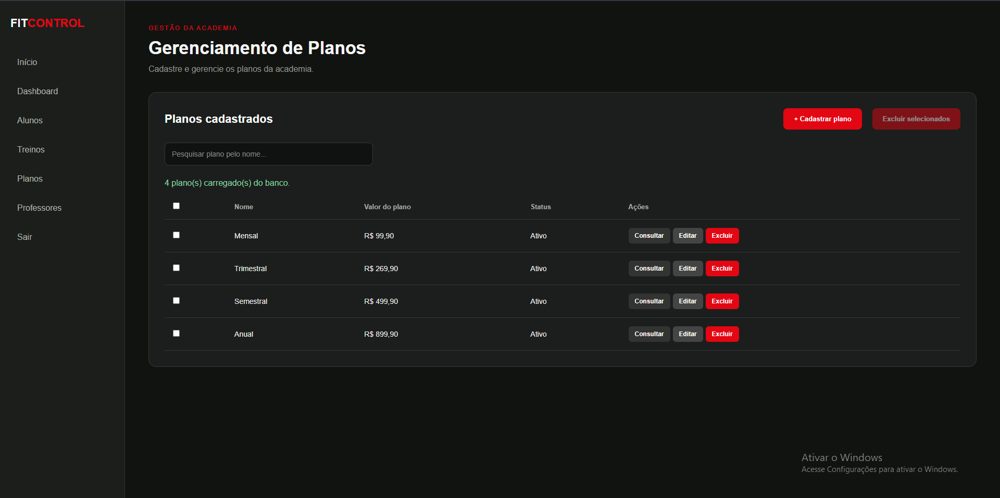
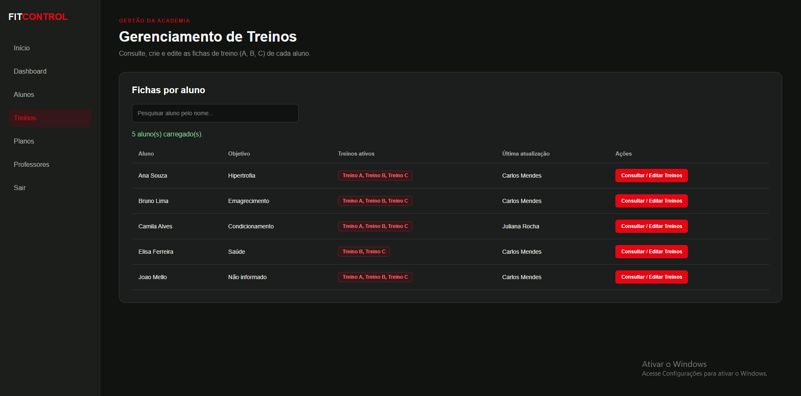
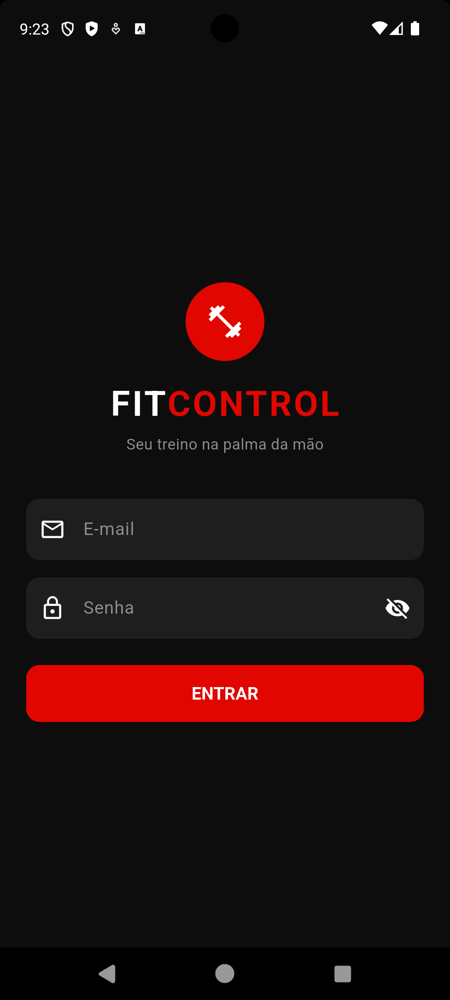
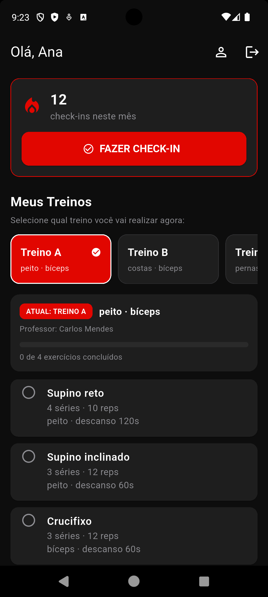
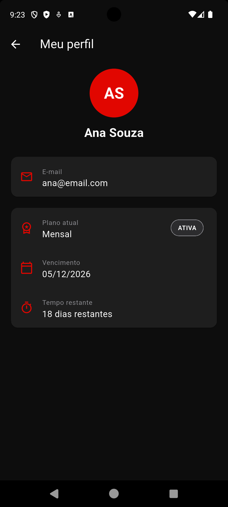

# 🏋️ Fit Control — Sistema Integrado de Gestão de Academias


O **Fit Control** é uma plataforma completa para administração de academias e acompanhamento de treinos, projetada com foco em segurança de dados em nível de linha (**Row-Level Security**), auditoria automática no banco de dados e registro de frequência integrado entre aplicativo mobile e painel administrativo.

---

## 🏗️ Arquitetura do Projeto

O repositório está organizado como um monorepo dividido em quatro módulos principais:

| Módulo          | Tecnologia Principal     | Responsabilidade                                                                                | Documentação                       |
| :-------------- | :----------------------- | :---------------------------------------------------------------------------------------------- | :--------------------------------- |
| **`/database`** | PostgreSQL & Docker      | Modelagem relacional, funções, views, triggers de auditoria, políticas RLS e seed inicial.      | [Ver README](./database/README.md) |
| **`/backend`**  | Java & Spring Boot       | API RESTful, autenticação JWT, propagação de contexto RLS e registro de check-in.               | [Ver README](./backend/README.md)  |
| **`/web`**      | HTML5, CSS3 & Vanilla JS | Painel administrativo para gestão de alunos, professores, planos, fichas de treino e dashboard. | [Ver README](./web/README.md)      |
| **`/mobile`**   | Flutter (Dart)           | Aplicativo do aluno para visualização de perfil, consulta de treinos e check-in direto na tela. | [Ver README](./mobile/README.md)   |

---

## ✨ Principais Funcionalidades

- **Autenticação e Controle de Acesso (JWT + RLS):** Sessões stateless via token JWT no back-end integradas às políticas de Row-Level Security no PostgreSQL, garantindo isolamento de dados entre perfis.
- **Check-in Direto pelo App:** Registro rápido de presença acionado por botão na interface do aluno, com validação e persistência imediata via API.
- **Painel Web Administrativo:** Cadastro e gerenciamento completo de alunos, professores, planos de assinatura e prescrição de treinos.
- **App Mobile do Aluno:** Interface dedicada em Flutter para acompanhamento de fichas de treino e dados cadastrais.
- **Trilha de Auditoria no Banco:** Registro automatizado de alterações críticas diretamente na camada de persistência.

---

## 🚀 Como Executar o Projeto

### 1. Pré-requisitos

- **Docker** e **Docker Compose**
- **JDK 17+** e **Maven** (ou uso do wrapper `./mvnw` incluso)
- **Flutter SDK** (para executar o aplicativo mobile)

### 2. Ordem de Inicialização

1. **Subir o Banco de Dados:**
   ```bash
   cd database
   cp .env.example .env
   docker compose up -d
   ```
2. **Iniciar a API Back-end:**
   ```bash
   cd ../backend
   cp .env.example .env
   ./mvnw spring-boot:run
   ```
3. **Executar o Painel Web:**
   Consulte as instruções de deploy/servidor local em [`web/README.md`](./web/README.md).
4. **Executar o App Mobile:**
   ```bash
   cd ../mobile
   flutter pub get
   flutter run
   ```

---

## 📸 Demonstração do Sistema

### 💻 Painel Web Administrativo

|                       Tela Principal                        |                       Dashboard                        |
| :---------------------------------------------------------: | :----------------------------------------------------: |
|  |  |

|                 Gestão de Alunos                 |                   Gestão de Professores                    |
| :----------------------------------------------: | :--------------------------------------------------------: |
|  |  |

|              Planos e Mensalidades               |                  Fichas de Treino                  |
| :----------------------------------------------: | :------------------------------------------------: |
|  |  |

---

### 📱 Aplicativo Mobile (Aluno)

|                               Login                                |                       Tela Principal & Check-in                        |                           Perfil do Aluno                           |
| :----------------------------------------------------------------: | :--------------------------------------------------------------------: | :-----------------------------------------------------------------: |
|  |  |  |
